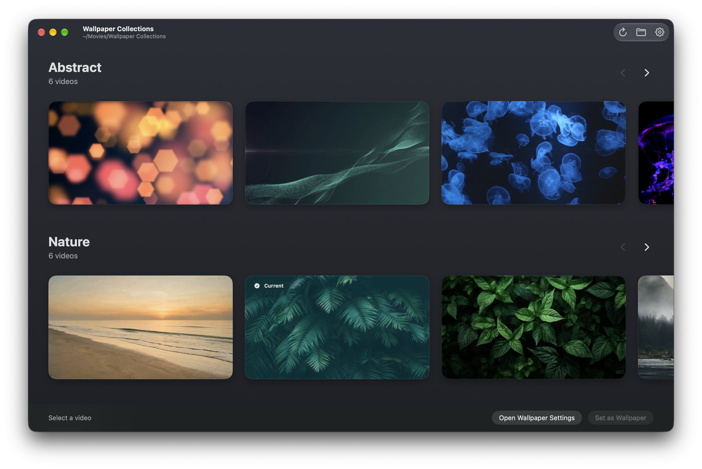
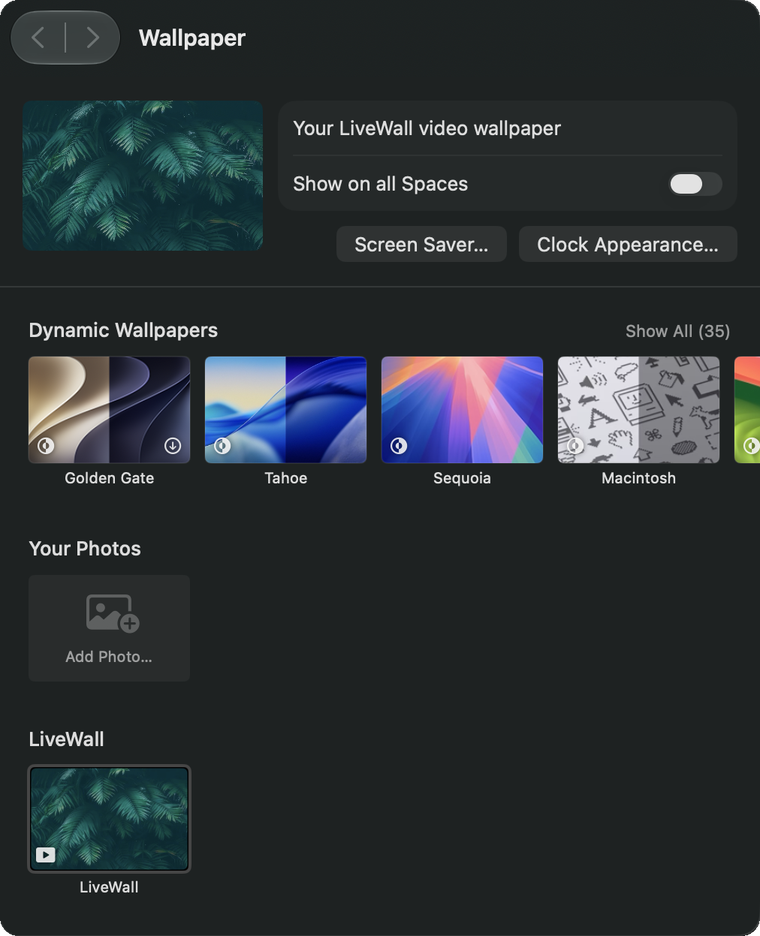
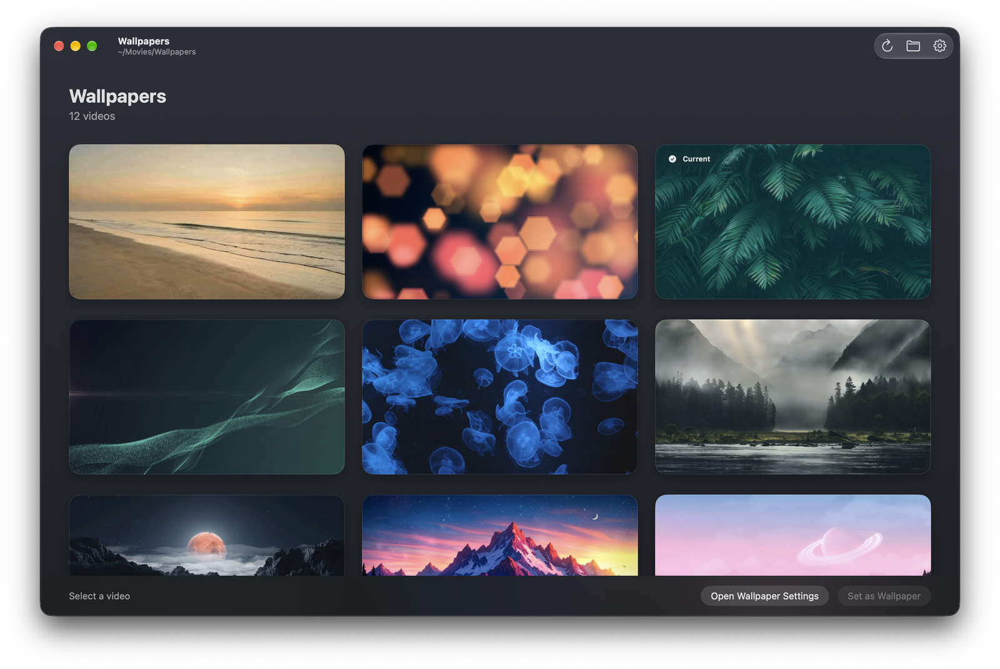
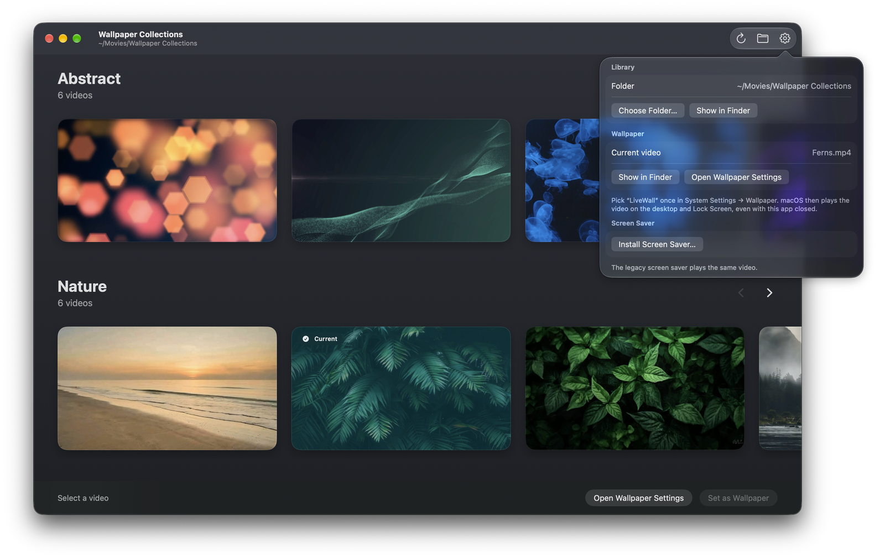
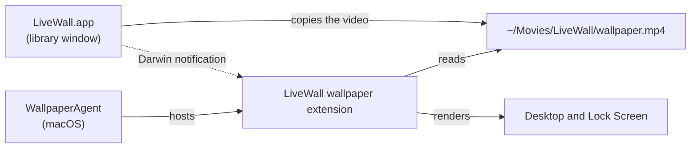

<p align="center">
  
</p>

<h1 align="center">LiveWall</h1>

<p align="center">
  Video wallpapers for macOS, played by the system's own wallpaper service on the desktop and the Lock Screen.<br>
  Pick a video and quit the app. The wallpaper keeps playing.
</p>

<p align="center">
  
  
  
  <a href="LICENSE"></a>
</p>

<p align="center">
  
</p>

## The app closes, the wallpaper keeps playing

The common way to put a video on a Mac desktop is an app that keeps a borderless window under the desktop icons and plays the video in it, so the app has to stay open as long as you want the wallpaper. LiveWall ships a wallpaper extension instead. macOS loads it into WallpaperAgent, the system service that also plays Apple's built-in wallpapers, and the extension plays your video there.

Once the wallpaper is set:

- You can quit LiveWall. It has no menu bar icon, no login item and no background process.
- LiveWall shows up in **System Settings → Wallpaper** next to Apple's wallpapers, and macOS treats it as a regular wallpaper.
- The same video plays on the desktop and on the Lock Screen.

<p align="center">
  
</p>

On a Mac with an Apple M5 Pro running macOS 27.0.1, a 1920×1080 H.264 wallpaper kept the extension at 1.3-1.5% of one CPU core and about 9.5 MB of memory (sampled with `top` every 4 seconds for 30 seconds, with LiveWall.app not running). The number covers the extension process only: video decoding and compositing happen in macOS system processes and are not included.

## Features

- A library window that lists every video in a folder you choose. Each subfolder becomes its own row with ‹ › paging; a folder without subfolders is shown as a grid.
- Hover over a card to preview the video in place, muted.
- Click a card to select it and press **Set as Wallpaper** (or Return) to apply it. The active wallpaper carries a **Current** badge.
- Changing the video while LiveWall is the active wallpaper swaps it immediately; you don't have to pick LiveWall in System Settings again.
- Playback pauses when macOS reports serious or critical thermal pressure and continues from the same frame once the Mac cools down.
- MP4, MOV and M4V files that AVFoundation can play, such as H.264 or HEVC.
- The folder is rescanned when you switch back to LiveWall, so files you add in Finder appear without a restart.
- An optional legacy screen saver that plays the same video.

## Screenshots

<p align="center">
  
  <br><em>A folder without subfolders is shown as a grid.</em>
</p>

<p align="center">
  
  <br><em>Settings live in a popover in the same window (⌘,).</em>
</p>

## Requirements

- macOS 26 or later. Tested on Apple Silicon with macOS 27.0.1.
- Xcode with the macOS 26 SDK or later to build. LiveWall is developed with Xcode 27.1.

## Install

There is no prebuilt download yet, so build LiveWall from source.

1. Clone the repository:

   ```bash
   git clone https://github.com/olchu/livewall.git
   cd livewall
   ```

2. Build a disk image:

   ```bash
   scripts/build_dmg.sh
   ```

   The script builds the Release configuration with an ad-hoc signature and writes `build/dist/LiveWall-<version>.dmg`. You can also open `LiveWall.xcodeproj` in Xcode and build the `LiveWall` scheme.

3. Drag **LiveWall** into **Applications** and open it. On first launch LiveWall registers its wallpaper extension with macOS and restarts WallpaperAgent, so the desktop may flicker once.

The build is not notarized. If you copy the disk image to another Mac, Gatekeeper blocks the first launch; open the app from **System Settings → Privacy & Security → Open Anyway**.

## Set a wallpaper

1. Open LiveWall and click **Choose Folder…** (⌘O).
2. Click a video, then click **Set as Wallpaper**.
3. The first time only: click **Open Wallpaper Settings** and pick **LiveWall** in the LiveWall group of **System Settings → Wallpaper**.
4. Quit LiveWall with ⌘Q. The wallpaper keeps playing.

To change the wallpaper later, open LiveWall, select another video and click **Set as Wallpaper**. Step 3 is not needed again.

## How it works

The app and the extension communicate only through one file and a one-way notification.



When you set a wallpaper, the app copies the video to `~/Movies/LiveWall/wallpaper.<ext>` and posts a Darwin notification. The extension runs inside WallpaperAgent in its own sandbox with read-only access to that folder. It decodes the video with `AVAssetReader` into an `AVSampleBufferDisplayLayer`, which WallpaperAgent composites on the desktop and the Lock Screen. If the extension is already playing, the notification makes it load the new video in place.

Since the extension needs only that file, quitting the app has no effect on playback. [SPEC.md](SPEC.md) describes the architecture in detail.

## Limitations

- The extension uses private macOS interfaces: the WallpaperExtensionKit framework and its XPC protocol are undocumented. A macOS update can break it, and the app cannot be published on the Mac App Store.
- One video plays on all displays and on the Lock Screen.
- Playback does not pause for full-screen apps or on battery power yet.
- System Settings shows a still thumbnail of the video in the wallpaper picker, not a live preview.
- There is no notarized build.

## Troubleshooting

### LiveWall does not appear in System Settings → Wallpaper

Open LiveWall once from **Applications**; the app registers the extension on launch. Check the registration:

```bash
pluginkit -m -v -i com.ochurkin.LiveWall.WallpaperExtension
```

The output should be one line that starts with `+` and points into `/Applications/LiveWall.app`.

### An old version keeps playing after an update

macOS can load the extension from another copy of LiveWall on disk, such as an old build in Xcode's DerivedData folder. List every registered copy, remove the extra ones, and restart WallpaperAgent:

```bash
pluginkit -m -v -p com.apple.wallpaper | grep -i livewall
pluginkit -r "/path/to/other/LiveWall.app/Contents/Extensions/LiveWallWallpaperExtension.appex"
killall WallpaperAgent
```

### Extension log

The extension writes its log to `~/Library/Containers/com.ochurkin.LiveWall.WallpaperExtension/Data/Documents/extension.log`.

## Contributing

[SPEC.md](SPEC.md) is the source of truth for behavior and architecture; read it before changing code, and update it together with the code. Issues and pull requests are welcome.

## Credits

The bridging header for the private wallpaper protocols and the bounds-checked runtime helpers in the extension are derived from [Phosphene](https://github.com/kageroumado/phosphene) by kageroumado, released under the MIT license. See [THIRD_PARTY_NOTICES.md](THIRD_PARTY_NOTICES.md).

## License

LiveWall is released under the [MIT license](LICENSE).
